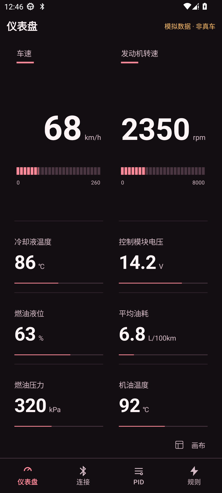
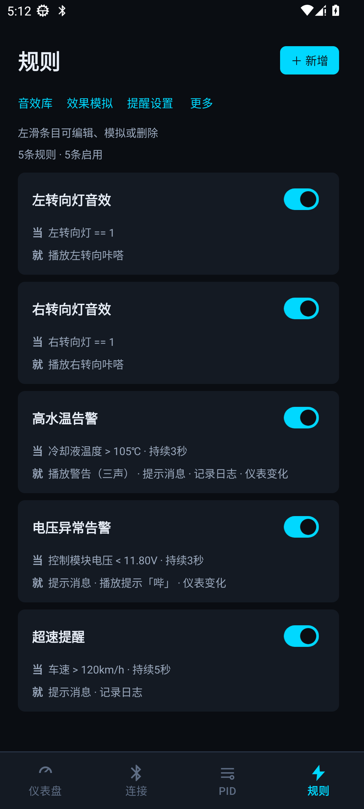
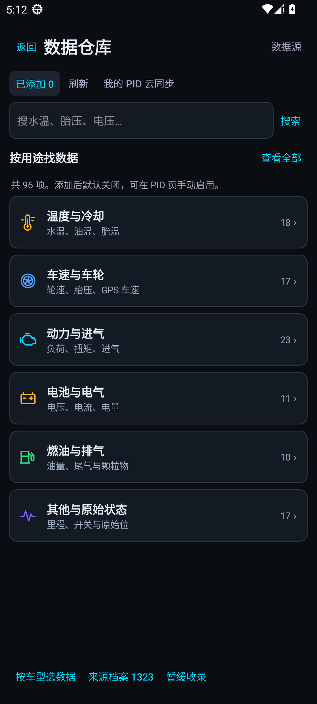

<strong>把车辆数据，变成清楚好读的仪表与提醒。</strong> Android 7.0+ · 手机与平板 · 当前提供签名 Release 版

<a href="https://github.com/misakashiny/iCarOBD/releases/download/v1.21.47/ICarOBD_1.21.47.apk"><strong>下载 1.21.47 APK</strong></a> · <a href="https://github.com/misakashiny/iCarOBD/releases/latest">最新发布</a> · <a href="INSTALL.md">安装说明</a> · <a href="CHANGELOG.md">更新记录</a>

---

## 下载与安装

<!-- current-release:start -->
**最新版本：1.21.47（139）** · 2026-11-11 · 36.33 MB

- 下载文件应以 **.apk** 结尾，直接安装，无需解压。
- 已安装 ICarOBD 时，使用同签名版本直接覆盖安装，保留现有配置与数据。
- App 内可从连接页进入“应用更新”，检查并下载新版。

[直接下载 APK](https://github.com/misakashiny/iCarOBD/releases/download/v1.21.47/ICarOBD_1.21.47.apk) · [本版本说明](https://github.com/misakashiny/iCarOBD/releases/tag/v1.21.47) · [版本对应记录](releases/v1.21.47.json)
<!-- current-release:end -->

## 界面预览

早期 Android 模拟器截图；仪表读数为模拟数据。

## 可以做什么

| 你想做的事 | ICarOBD 提供 |
| :--- | :--- |
| 看得清 | 默认仪表主题、读数平滑变化、横竖屏与平板适配 |
| 自己设计仪表 | 导入 ICarUI 主题、独立全屏画布、在线主题库 |
| 管理数据 | PID 编辑与探测、CAN 探测与记录、审核后的数据目录 |
| 获得提醒 | 条件规则、音效库与收藏、效果模拟、提醒设置 |
| 保存自己的配置 | 本机 PID 离线使用，可选择同步到私有 GitHub 数据源 |
| 排查问题 | 日志、CSV 行车记录、知识库与控件检视 |

实际可读取的数据取决于车辆、适配器和对应 PID 定义。功能模拟与界面测试不代表已完成实车适配。

## 1.21.47 更新重点

- 默认日常界面迁移到 Flutter，旧 ICarUI 画布继续使用独立全屏运行器。
- 新增 RED-02 黑红、冰川 HUD、白昼简约三套在线应用外观，支持预览、应用和恢复。
- 修复扫表和快滑卡顿、规则开关误触，以及旧画布长读数裁切。
- 与旧版本同签名，可覆盖升级并保留设置、PID、规则和画布。

## 仓库分工

| 仓库 | 内容 |
| :--- | :--- |
| **ICarOBD · 本仓库** | APK、更新说明、发行校验与展示资料 |
| [ICarOBD-Private](https://github.com/misakashiny/ICarOBD-Private) | 安卓 App 的源码、资源与测试，需要授权访问 |
| [ICarUI-Theme](https://github.com/misakashiny/ICarUI-Theme) | 公开主题原件、预览、在线下载目录 |
| [ICarUI-Private](https://github.com/misakashiny/ICarUI-Private) | 配套主题编辑器源码，需要授权访问 |
| [ICarOBD-Data-Private](https://github.com/misakashiny/ICarOBD-Data-Private) | 数据目录、审核资料与个人 PID，需要授权访问 |

本仓库的主分支已整理为发行入口。旧公开源码保留在 Git 历史和历史标签中；它们不代表最新 APK 的源码。

**不要把 Releases 自动生成的 Source code.zip 当成 APK 或最新 App 源码。** 最新 App 的对应私有源码提交见每个版本的 source.json / 版本对应记录。历史版本未建立映射的，会明确标记。

现有 [theme-library 分支](https://github.com/misakashiny/iCarOBD/tree/theme-library) 继续提供主题下载，保持已安装版本的主题源地址有效。

## 更新与校验

应用更新读取 [最新 update.json](https://github.com/misakashiny/iCarOBD/releases/latest/download/update.json)，核对版本、文件大小、SHA-256 和安装签名。检查与下载由用户发起，安装由 Android 系统确认。

1.21.47 已在 K80 Pro 完成离线扫表、TalkBack 双击、分屏和配置保全检查，也通过 Android 7 保存回读。三套外观已从 GitHub 下载并应用，个人 PID 云同步已使用合成数据验证。实车与实体 OBD 适配器尚未验证。

1.21.47 文件完整性

文件：ICarOBD_1.21.47.apk  
大小：36,333,639 字节  
SHA-256：`2d3e283f60d988e67b3952aada65b125b466d2319a5f20426552d071a248bec2`

[查看全部版本](https://github.com/misakashiny/iCarOBD/releases) · [报告使用问题](https://github.com/misakashiny/iCarOBD/issues)
