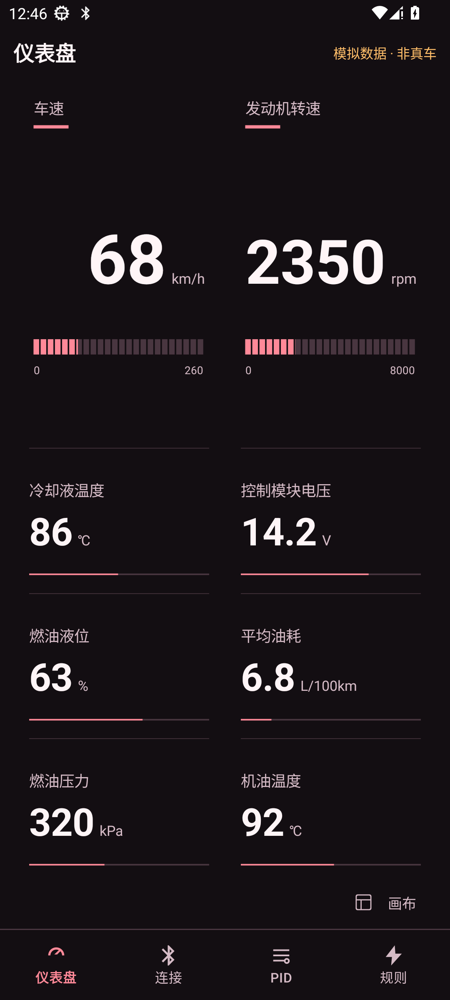
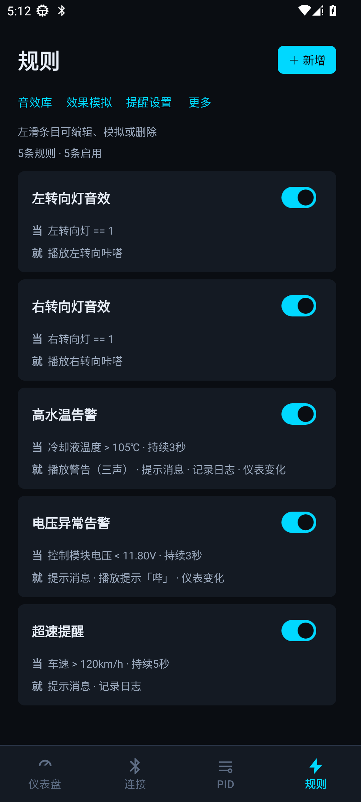
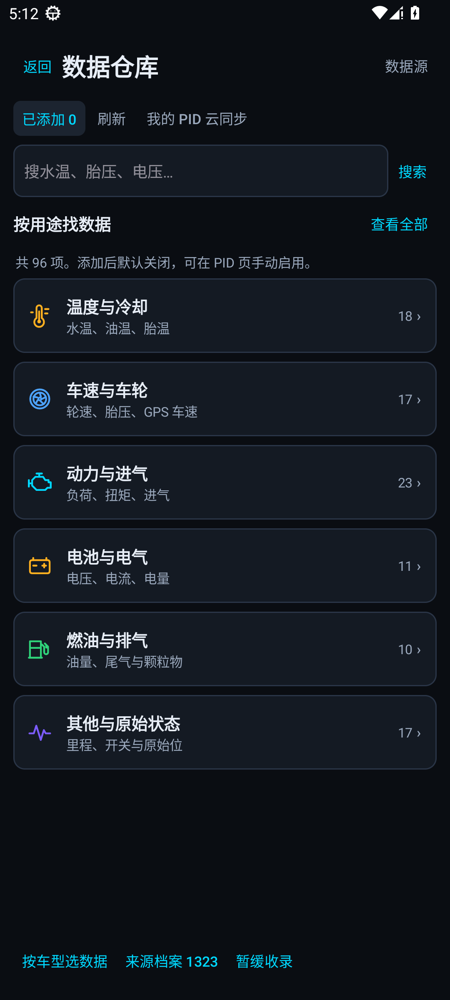

<strong>把车辆数据，变成清楚好读的仪表与提醒。</strong> Android 7.0+ · 手机与平板 · 当前提供签名 Release 版

<a href="https://github.com/misakashiny/iCarOBD/releases/download/v1.21.62/ICarOBD_1.21.62.apk"><strong>下载 1.21.62 APK</strong></a> · <a href="https://github.com/misakashiny/iCarOBD/releases/latest">最新发布</a> · <a href="INSTALL.md">安装说明</a> · <a href="CHANGELOG.md">更新记录</a>

---

## 下载与安装

<!-- current-release:start -->
**最新版本 1.21.62-asuka-motion（154）** · 2026-11-18 · 49.09 MB

明日香 · 二号机仪表首页加入一次装甲扣合和铭牌扫光。横竖屏卡榫分别沿各自画框的真实折线就位。拉转速时，短拖光贴着已点亮区域的斜边；稳态和收油时恢复原转速条。
长按底部「仪表盘」，在仪表设置的本机主题中选择「明日香 · 二号机」，点击「应用外观」。已经使用明日香主题的用户直接进入仪表首页即可。

[直接下载 APK](https://github.com/misakashiny/iCarOBD/releases/download/v1.21.62/ICarOBD_1.21.62.apk) · [本版本说明](https://github.com/misakashiny/iCarOBD/releases/tag/v1.21.62) · [版本对应记录](releases/v1.21.62.json)
<!-- current-release:end -->

## 界面预览

早期 Android 模拟器截图；仪表读数为模拟数据。

## 可以做什么

| 你想做的事 | ICarOBD 提供 |
| :--- | :--- |
| 看得清 | 默认仪表主题、读数平滑变化、横竖屏与平板适配 |
| 自己设计仪表 | 导入 ICarUI 主题、独立全屏画布、在线主题库 |
| 管理数据 | PID 编辑与探测、CAN 探测与记录、审核后的数据目录 |
| 获得提醒 | 条件规则、音效库与收藏、效果模拟、提醒设置 |
| 保存自己的配置 | 本机 PID 离线使用，可选择同步到私有 GitHub 数据源 |
| 排查问题 | 日志、CSV 行车记录、知识库与控件检视 |

实际可读取的数据取决于车辆、适配器和对应 PID 定义。功能模拟与界面测试不代表已完成实车适配。

## 1.21.61 更新重点

- 新增星野爱「星光舞台」横竖屏仪表首页，人物、舞台与实时数据分层呈现。
- 连续转速灯弧、星形端点与辅助数据光轨，保留稳定的数字槽和单位位置。
- 保留明日香主题、现有绑定/规则/画布与重构后的功能入口；90/100/115%应用字号独立于系统。
- 星野爱本轮仅实现首页，其他页面继续沿用现有外观。

## 仓库分工

| 仓库 | 内容 |
| :--- | :--- |
| **ICarOBD · 本仓库** | APK、更新说明、发行校验与展示资料 |
| [ICarOBD-Private](https://github.com/misakashiny/ICarOBD-Private) | 安卓 App 的源码、资源与测试，需要授权访问 |
| [ICarUI-Theme](https://github.com/misakashiny/ICarUI-Theme) | 公开主题原件、预览、在线下载目录 |
| [ICarUI-Private](https://github.com/misakashiny/ICarUI-Private) | 配套主题编辑器源码，需要授权访问 |
| [ICarOBD-Data-Private](https://github.com/misakashiny/ICarOBD-Data-Private) | 数据目录、审核资料与个人 PID，需要授权访问 |

本仓库的主分支已整理为发行入口。旧公开源码保留在 Git 历史和历史标签中；它们不代表最新 APK 的源码。

**不要把 Releases 自动生成的 Source code.zip 当成 APK 或最新 App 源码。** 最新 App 的对应私有源码提交见每个版本的 source.json / 版本对应记录。历史版本未建立映射的，会明确标记。

现有 [theme-library 分支](https://github.com/misakashiny/iCarOBD/tree/theme-library) 继续提供主题下载，保持已安装版本的主题源地址有效。

## 更新与校验

应用更新读取 [最新 update.json](https://github.com/misakashiny/iCarOBD/releases/latest/download/update.json)，核对版本、文件大小、SHA-256 和安装签名。检查与下载由用户发起，安装由 Android 系统确认。

1.21.61 最终 APK 已通过手机竖屏、横屏、平板及115%应用字号四组模拟器检查、冷启动与配置保全验证。本版尚未在实体手机、实车或实体 OBD 适配器上验收。

1.21.61 文件完整性

- 文件：ICarOBD_1.21.61.apk
- 大小：49,065,954 字节
- SHA-256：`65fd442749cfa0df67f6f2d4e1da7b7de94cb3d89937c11bc7437d8cca69f98b`

[查看全部版本](https://github.com/misakashiny/iCarOBD/releases) · [报告使用问题](https://github.com/misakashiny/iCarOBD/issues)
